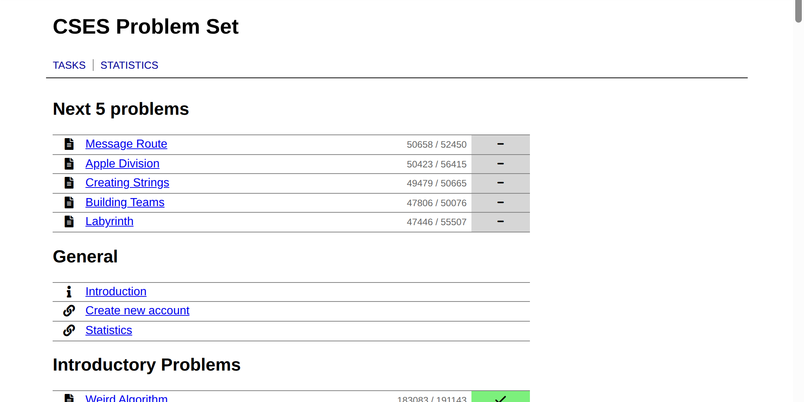

# CSES Trainer

Browser extension that shows your next 5 unsolved CSES problems, ranked by how many people solved them.



## Install

1. Download the zip from the [latest release](https://github.com/menzhik/cses-trainer/releases/latest).
2. Unzip it, open `chrome://extensions` and turn on **Developer mode**.
3. Click **Load unpacked** and pick the unzipped folder.
4. Open https://cses.fi/problemset/.

## Development

```sh
pnpm install
pnpm dev
```

## Acknowledgments

[CSES Problem Set](https://cses.fi/problemset/) is created and maintained by Antti Laaksonen. CSES Trainer is an unofficial project and is not affiliated with CSES.

## License

[MIT](LICENSE)
